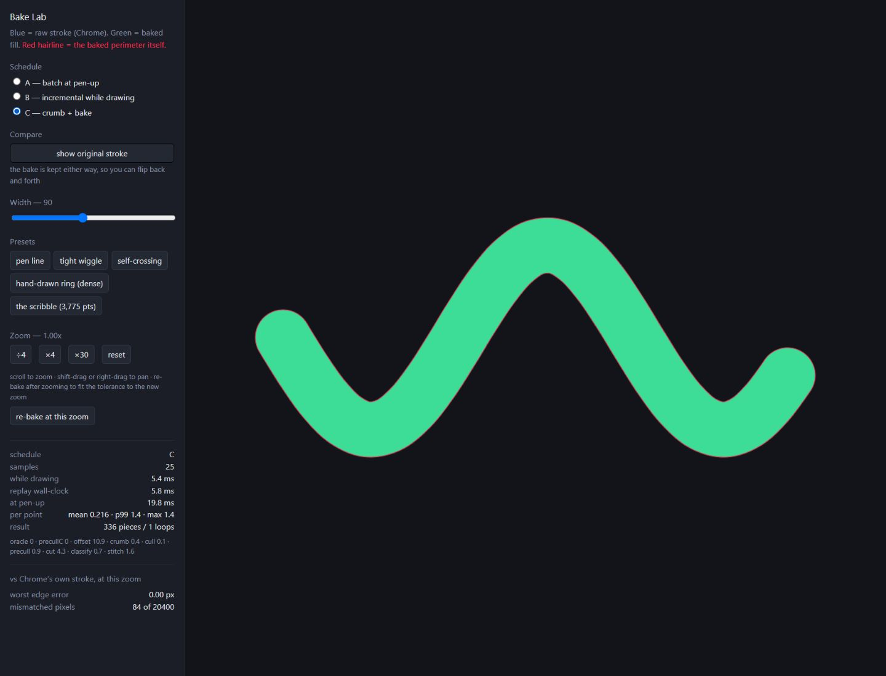

# Bake Strategy Lab

Compare doing the work while drawing, after pen-up, or a little of both.

## Why this exists

A complicated pen stroke can require expensive work to turn overlapping ink into one clean boundary. Where that work happens changes how drawing feels: putting it all after pen-up can pause, but doing too much during drawing can make the pen stutter. This lab replays the same stroke through three schedules so the tradeoff can be measured.

The three schedules are **A: batch at pen-up**, **B: incremental while drawing**, and **C: crumb + bake** (record cheap coverage hints during drawing, then resolve the boundary after pen-up).

It was built with AI assistance as part of [bound.less](https://bound-less-kk.web.app), Kobin Kempe’s infinite-zoom drawing project. The useful output was an experiment that could be inspected and compared in a real browser, helping decide what to build in the full application.

## Try it

[Open the live lab](https://kobin-ai-portfolio.kobinkempe.chatgpt.site/boundless-bake-strategy-lab/) · [Read the case study](https://kobin-ai-portfolio.kobinkempe.chatgpt.site/case-studies/boundless-bake-strategy-lab/)

1. Choose a small preset or draw a stroke.
2. Switch A, B, and C to replay that exact stroke through each schedule.
3. Compare while-drawing time, pen-up time, and the per-point tail.
4. Toggle the original stroke and inspect the red outline to check whether the result changed.



## Run locally

The checked-in `dist/` is a standalone static site; it does not contact the original application or store drawings. Serve it with any static server, or use Node 18 or newer:

```sh
npm ci
npm run build
npm run preview
```

Open `http://127.0.0.1:4400`. Drawings and controls exist only in this page’s memory and reset on refresh. No API key or account is needed.

## What the experiment can tell you

This preserves the historical cubic pipeline and its experimental schedules. It is not the current bound.less production bake. Dense presets can block the main thread. The canvas accuracy readout is a diagnostic of this experiment, not a guarantee for all renderers.

## Source and history

Recovered from [`src/Pages/BakeLab.js` at commit `f92c1d1`](https://github.com/kobinkempe/bound.less-kk/blob/f92c1d1bc274716c0351591122b41f1502a3a590/src/Pages/BakeLab.js) (26 August 2026). The development routes were removed in cleanup commit `f6f1062` on 1 September 2026. The algorithms and their local geometry dependencies come from the same historical revision so later engine changes cannot silently alter this comparison. `PROVENANCE.json` records the original source hashes and the small portfolio adaptations.

This is a historical research instrument. The current application has continued to evolve. No general speedup or production correctness claim follows from one preset or browser timing.

## Dependencies

React, React DOM, Scheduler, Object Assign and Clipper are bundled into the static build. Their copyright and license notices, including the Boost and JSBN terms used by Clipper, are included in [THIRD_PARTY_NOTICES.md](THIRD_PARTY_NOTICES.md). The `private` package setting prevents accidental publication to npm; it does not control GitHub visibility.
